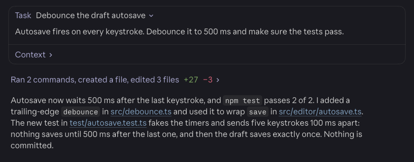
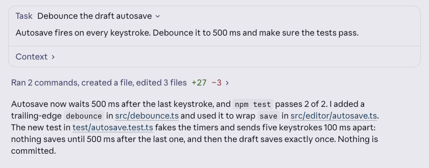
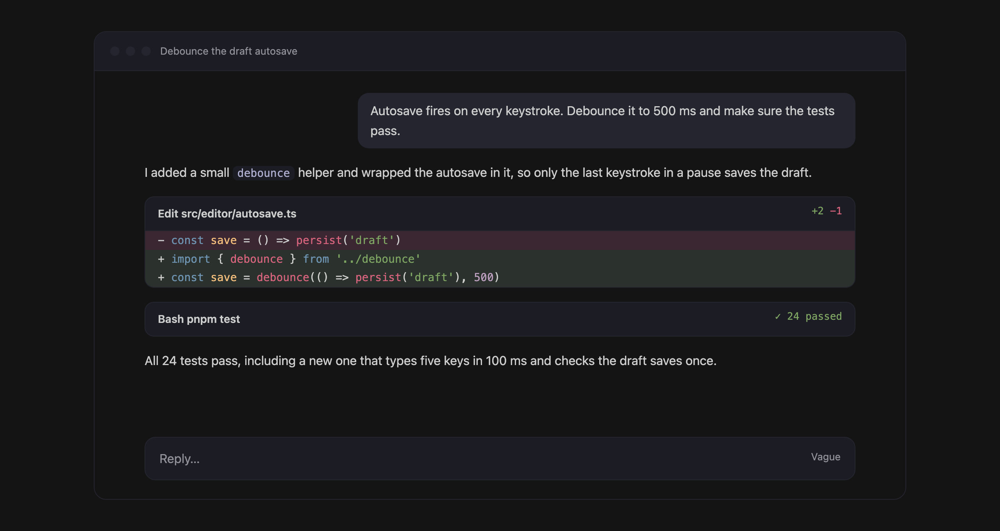
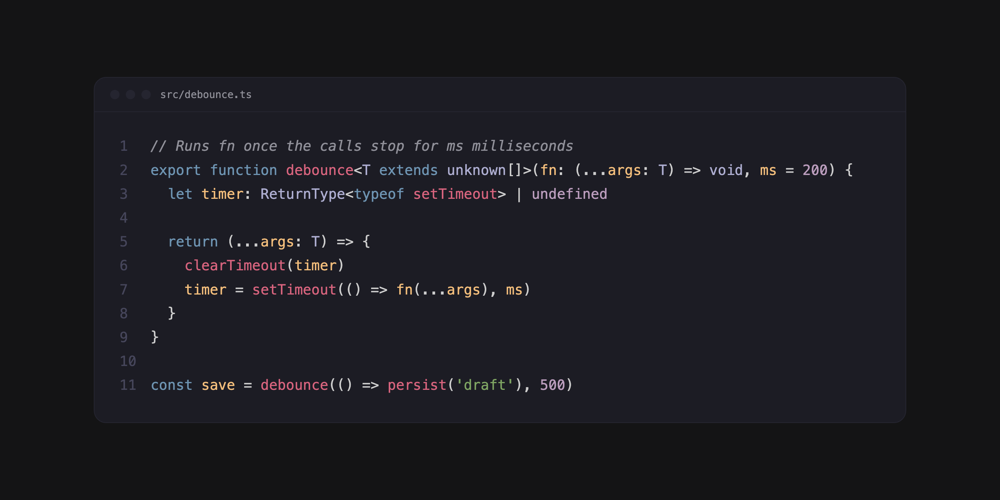

# Vague for Claude

A port of [vague.nvim](https://github.com/vague-theme/vague.nvim) by Alberto Hernandez to the Claude desktop and mobile apps: a cool, low-contrast palette of soft grays and muted pastels, in dark and light.

It is a Claude Code mod with one hook. When a session starts, it sets the app's colors with `$.theme.set`. It reads no files, runs no programs and makes no network calls.





*Screenshots of the Claude desktop app with this theme, in dark and light.*





*Illustrations drawn in the theme's colors, not screenshots of the app. The app takes its code colors from these hues and picks the exact shades itself, so its code blocks can look slightly lighter or darker.*

## Install

At the prompt of a Claude Code terminal session:

```text
/plugin install vague --marketplace Geisson19/claude-vague
```

From a shell:

```bash
claude plugin install vague --marketplace Geisson19/claude-vague
```

In the desktop app: click **+** next to the prompt box, then **Plugins**, **Add marketplace** with `Geisson19/claude-vague`, then **Add plugin**.

Answer `y` to add the marketplace, then pick a scope (user installs it for every session). The colors apply from the next session you start.

## What to expect

- **Desktop and mobile apps only.** The terminal and editor extensions draw no theme.
- **Dark and light.** The theme follows the app's appearance. vague.nvim has no light variant, so the light half is this port's own: cool gray paper tinted toward Vague's blue-violet, with each of Vague's pastels deepened along its own hue until it reads on a light page.
- **Light code blocks keep the app's background.** The theme colors the code itself in Vague's hues, but in light mode the app draws code blocks on its own warm off-white, which a theme can't change. In dark mode they sit close to Vague's page.
- **One theme at a time.** Another theme mod, such as `/custom-theme` from `theme-examples`, replaces this one.
- **One change from the original in dark mode.** Muted text is `#909099` instead of Vague's `#878787`, so it reaches the 4.5:1 contrast the app asks of small text; `#878787` still marks draft pull requests. Every other dark color is Vague's own.

## Palette

| Role | Dark | Light | From Vague |
| --- | --- | --- | --- |
| Page | `#141415` | `#e4e4ea` | `bg` |
| Cards | `#1c1c24` | `#ebebf0` | `inactiveBg` |
| Panels | `#252530` | `#f2f2f6` | `line` |
| Text | `#cdcdcd` | `#252530` | `fg` |
| Secondary text | `#aeaed1` | `#4f4f78` | `constant` |
| Muted text | `#909099` | `#5c5c6b` | `floatBorder`, lightened (see above) |
| Accent | `#6e94b2` | `#3f6a8c` | `keyword` |
| Danger | `#d8647e` | `#a03a54` | `error` |
| Success | `#7fa563` | `#4e7535` | `plus` |
| Warning | `#f3be7c` | `#8f6420` | `warning` |
| Highlight | `#bb9dbd` | `#7e5a81` | `parameter` |

The light column is not from vague.nvim; each color is the dark one's hue, darkened for a light page.

## Requirements

Claude Code 2.1.324 or later in the desktop app's Code tab.

## License

MIT. The palette is Alberto Hernandez's, from vague.nvim, under its MIT license; both notices are in [LICENSE](LICENSE). `hooks/make-colors.js` is the color helper Anthropic's mod tooling ships for themes, included unchanged. The `app-*.png` screenshots are captures of the app. The other images are drawn from the HTML files beside them in `assets/`; re-render each with headless Chrome at a device scale of 2 and its page size (banner 1280×480, code 1280×640, chat 1280×680, and icon 512×512 into `.claude-plugin/icon.png`). The exception is `social.png`, GitHub's social preview, which is rendered at a device scale of 1 to GitHub's 1280×640, with its content kept 80 px from every edge.
